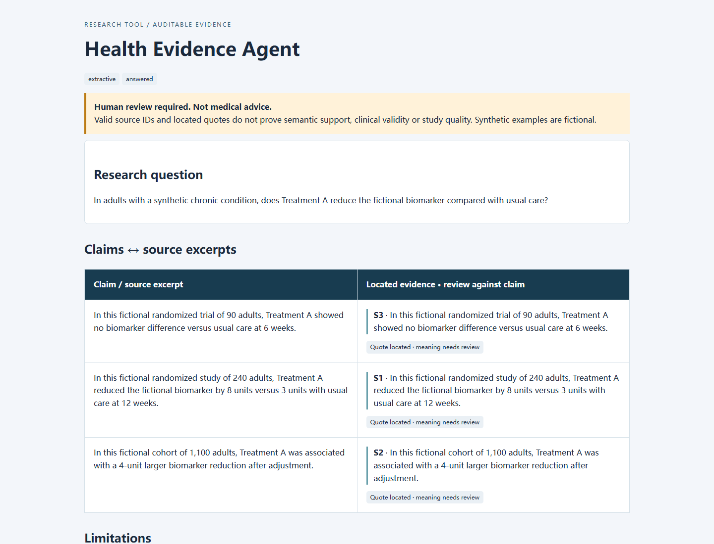

# Health Evidence Agent

[](https://github.com/TonyZhu233/health-evidence-agent/actions/workflows/test.yml)

An auditable **research evidence workflow**: retrieve abstracts, locate claim-level source excerpts, and inspect the answer beside its evidence. Python standard library only. No account, API key or paid model is needed for the offline demo.

**Research prototype, not medical advice. Located citations do not prove semantic support or clinical validity.** All committed study examples are fictional; real PubMed abstracts stay local by default.

## See it in 60 seconds

1. Read the [sample evidence packet](results/demo/REPORT.md).
2. Inspect the [evaluation and its retained failure](results/evaluation/REPORT.md).
3. Run it locally with Python 3.12+:

```sh
python agent.py --output runs/my-demo
python evaluate.py --output runs/my-evaluation
python -m unittest discover -s tests -v
python verify_artifacts.py runs/my-demo
```

Open `runs/my-demo/review.html` in your browser for a responsive, side-by-side review. The HTML has no JavaScript, third-party assets or external requests. Output paths must be new, to avoid overwriting prior runs. `runs/` is ignored by Git. There are **no third-party Python dependencies** to install.

The default demo uses BM25 retrieval over eight fictional abstracts and a deterministic **extractive baseline**. It copies relevant source sentences; it is not simulated LLM output.



## What is implemented

| Layer | Implementation | Boundary |
|---|---|---|
| Retrieval | Explicit PubMed ESearch → EFetch; local BM25 reranking; bounded top-k | No systematic-review completeness or synonym understanding |
| Generation | Extractive baseline or optional OpenAI Responses API, strict JSON schema | No autonomous tools, clinical advice, or inference from external knowledge |
| Evidence contract | Required claims, known source IDs, exact abstract quotes, valid abstentions | Quote location is **not** semantic entailment |
| Review | Claim/excerpt table, full selected abstracts, limitations, mode labels | Human review still required |
| Evaluation | 8 retrieval cases, 20 invalid-payload cases, explicit semantic counterexample | Authored synthetic regression set, not an independent benchmark |
| Operations | Timeouts, fixed service hosts, redirect refusal, response-size caps, no auto retries, cost guard, usage/latency, input fingerprints | No production SLA, shared-IP rate limiter or provider-enforced spending cap |

Data flow: `question + local corpus / PubMed → BM25 top-k → extractive / model → contract checks → review packet`.

## Results you can reproduce

On the committed **synthetic** suite, the baseline obtains mean Recall@3, MRR@3 and nDCG@3 of **0.857 over seven answerable retrieval questions**, and matches expected answer/abstention status on **7/8** cases. All **20 deliberately invalid contract payloads** are rejected.

The miss is retained: “insomnia behavioral therapy” does not lexically match the sleep/relaxation abstract. A second counterexample demonstrates that a fabricated survival claim paired with a genuine biomarker quote **passes quote-location validation**. These results are not an LLM hallucination rate, clinical accuracy, or generalization estimate. See [evaluation methodology](docs/EVALUATION.md).

The tests exercise input boundaries, retrieval, contract failures, API request construction with mocks, refusals/incomplete responses, transport sanitization, cost reservations, PubMed parsing/provenance and artifact escaping/checksums. Offline CI runs on Windows/Linux and Python 3.12/3.13; it never uses a secret or paid API.

## Optional: real PubMed retrieval

Review the search expression yourself; the system does not ask an LLM to invent it.

```sh
python retrieve_pubmed.py --query "hypertension[Title] AND randomized controlled trial[Publication Type]" --question "What outcomes were reported in randomized hypertension trials?" --limit 3 --output runs/pubmed.json
python agent.py runs/pubmed.json --output runs/pubmed-review
```

Each search logs the original/translated query, sort, count, retrieval time, requested PMIDs and records excluded for missing abstracts. `--limit` is bounded to 1–20. The 0.4-second delay is only a courtesy throttle in this two-request pipeline; concurrent clients can still exceed the shared-IP quota. Follow [NCBI usage requirements](https://eutilities.github.io/site/API_Key/usageandkey/) and its [disclaimer/copyright notice](https://www.ncbi.nlm.nih.gov/About/disclaimer.html). PubMed accessibility is not blanket redistribution permission. Do not commit fetched abstracts without reviewing rights.

## Optional: real model synthesis

Set `OPENAI_API_KEY` **outside the repository**, through your operating system or secret manager. Never put credentials in study files or commit them. GitHub/ChatGPT login is not an API key or API credit.

```sh
python agent.py --mode openai --model gpt-5.4-mini --max-cost-usd 0.10 --output runs/live-demo
python evaluate.py --live --max-cost-usd 0.25 --output runs/live-evaluation
python evaluate_behavior.py --max-cost-usd 0.25 --output runs/live-behavior
```

The existing model choice is preserved. The [official model page](https://developers.openai.com/api/docs/models/gpt-5.4-mini) lists standard uncached input/output prices of $0.75/$4.50 per million tokens (checked 2026-10-11). The guard reserves a conservative byte-based input estimate plus an overhead allowance and at most 2,000 output tokens before each call. Failed calls retain their reservation; no automatic retries. This is an **estimate, not a billing guarantee**; verify current pricing and set provider-side limits. For another compatible model, pass explicitly verified `--input-price` and `--output-price` values.

Reports record returned model, usage, latency and uncached cost estimate where provided. Missing usage remains unknown, not zero. Incomplete, refused or invalid reports are not published. `store=false` disables response storage but does **not** establish zero retention or permission to send sensitive data. The integration follows [OpenAI Structured Outputs documentation](https://developers.openai.com/api/docs/guides/structured-outputs?api-mode=responses); schema adherence still does not ensure factual correctness.

Actual external-test status is recorded separately in [validation notes](docs/VALIDATION.md). Mocked tests are never described as live model validation.

## Design decisions and limitations

- Remove an uncited free-form “answer” field; the displayed factual answer comes from the claim list. The abstention reason and limitations still require review.
- Replace unsupported self-rated “certainty” with explicit source excerpts and review status. There is no automated GRADE assessment.
- Treat abstracts and questions as untrusted data in the model instructions. There is no reliable prompt-injection defense or clinical-intent classifier claimed here; offline contract tests do not prove model resistance.
- Start with an inspectable lexical baseline. Embeddings, query expansion and entailment judges are future experiments, not implemented claims.
- Synthetic examples make the demo freely reproducible without patient data or reproducing publishers' abstract corpora. Public examples do not establish clinical utility.

## Project map

```text
agent.py               pipeline + CLI
evidence.py            bounded inputs, BM25, quote-location contract
clients.py             fixed-host PubMed / OpenAI transports and cost guard
retrieve_pubmed.py     reproducible, user-reviewed literature retrieval
reporting.py           JSON / Markdown / escaped HTML + checksum manifest
evaluate.py            reproducible synthetic evaluation + failure readout
evaluate_behavior.py   optional live conflict/abstention/injection smoke cases
verify_artifacts.py    artifact integrity and independent quote checks
evals/                 explicit relevance labels
tests/                 offline regression tests
results/               committed fictional demo and offline evaluation
docs/                  methods, validation and interview walkthrough
```

See [architecture](docs/ARCHITECTURE.md), [evaluation](docs/EVALUATION.md) and [interview walkthrough](docs/INTERVIEW.md). Version 2 deliberately changes the original report contract: `status/reason/claims/limitations`, where each claim has `text/evidence` rather than IDs and self-rated certainty. The CLI is now free/offline by default; paid generation requires `--mode openai`.

## Data and license

No patient data, confidential employer/lab material, student submissions, or unpublished research belong in this repository or in API prompts. User-created output packets contain their supplied source text; review them before sharing. MIT applies to project code and authored fictional fixtures, not to third-party material retrieved from PubMed.
